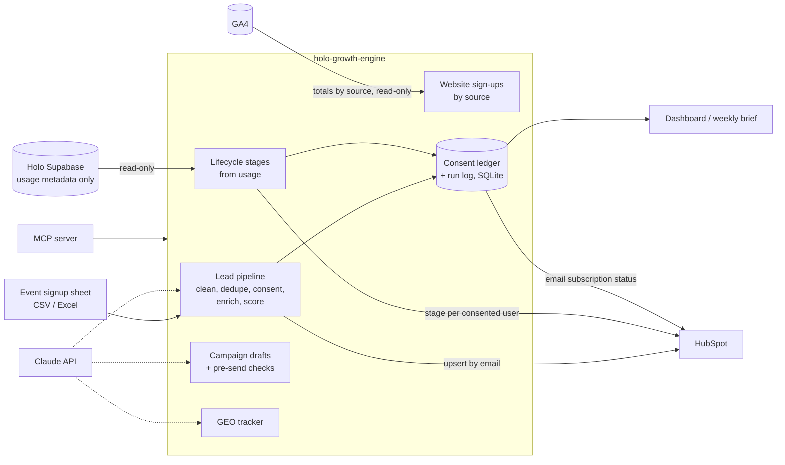

# Holo Growth Engine

The go-to-market system behind [Holo](https://github.com/Lihini0202/holoapp), a dating-safety app
that reads a conversation and tells you whether the other person is losing interest.

Holo is the product. This repo is everything around it that turns events and signups into
active users: an event lead pipeline into HubSpot, lifecycle stages from real product usage,
campaign emails that are checked before anyone sends them, and a tracker for how Holo shows up
when people ask AI assistants for help. All of it can be run from the command line, a
dashboard, or by asking Claude through an MCP server.

```
$ holo-growth leads process saturday_signups.csv --event "Online Dating Safety Workshop - Colombo"

Online Dating Safety Workshop - Colombo: 123 rows read, 3 rejected, 9 duplicates merged,
33 without consent (not uploaded). CRM: 78 created, 0 updated, 0 failed. 47 sent to review,
20 hot leads. Subscriptions: 78 subscribed, 0 unsubscribed.
```

Everything runs offline with no API keys (rules instead of an LLM, a local SQLite CRM,
synthetic Holo users and website traffic), so you can try it in two minutes:

```bash
pip install -e ".[dev,dashboard]"
holo-growth demo                     # runs every part end to end on synthetic data
HOLO_GROWTH_DB=demo.db streamlit run dashboard/app.py
```

## How it fits together



| Part | What it does | Job it automates |
|---|---|---|
| **Lead pipeline** | Maps messy columns, fixes email typos (`gmial.com`), normalises Sri Lankan phone numbers, merges duplicates, drops anyone who didn't opt in, enriches with Claude (persona, intent, language), scores, and upserts to HubSpot | Event list cleanup, enrichment and upload, same day |
| **Lifecycle sync** | Reads who used Holo and when, puts each user in a stage (new, activated, engaged, at risk, dormant), counts predictions waiting for the user to confirm what happened, syncs consented users to HubSpot | CRM data entered once, from the source |
| **Campaign checks** | Drafts lifecycle emails (Claude or templates) and blocks anything with false urgency, guarantees, accuracy claims, off-brand tone, unknown links, or a hint about someone's private analyses | Content checks before publishing |
| **GEO tracker** | Asks Claude (and any OpenRouter model) the questions Holo users ask, records whether Holo is named and which competitors are | Tracking how we show up in AI search |
| **Website sign-ups** | Pulls sessions and sign-ups per day and source from GA4 (Instagram, event QR codes, ChatGPT referrals...) into the funnel and the brief | Knowing which channels bring sign-ups |
| **Reports** | Event funnel (lead to user to active), stages, website sign-ups by source, AI visibility, review queue, as a dashboard and a markdown weekly brief | Pipeline reporting |
| **MCP server** | Eleven tools so anyone can run the above by asking Claude | Reusable tools the team can run |

## Decisions worth explaining

**The CRM never sees anything about anyone's conversations.** Holo's model predicts whether
a user's *chat partner* is about to ghost them. That is sensitive, and it is about a third
person who never signed up for anything. So the growth engine reads only usage metadata
(who ran an analysis, when, whether they recorded the outcome) and the Supabase query selects
exactly those three columns. There is a test that fails if a risk field ever reaches the CRM,
and a content rule that fails any email mentioning risk bands or "your conversation with".

**Lifecycle comes from usage, not the ghosting model.** It would be tempting to reuse the
model for churn, but it doesn't predict churn: it predicts what happens in someone else's
conversation. Stages are simple, explainable rules on activity instead.

**Consent is a ledger, not a checkbox.** Every grant and withdrawal is stored with its
source and time. No record means no marketing. An unsubscribe always wins: re-importing an
old signup sheet can't re-subscribe someone, and a stale "yes" from the app can't either,
only a newer explicit choice can. People who said no are counted and then dropped; their
details aren't stored. People who unsubscribe are told to the CRM exactly once, so its
workflows stop, and never again. In HubSpot the ledger drives the contact's own email
subscription status, not just a custom property: an outbox pushes each change once, with
where and when the choice was made as the legal basis note, and retries anything HubSpot
didn't accept. (This comes from six months building consent delegation for WSO2's OpenFGC.)

**The model's output is checked, not trusted.** Enrichment uses forced tool use with the
Pydantic schema, validates the result, retries once with the validation error, and falls back
to rules if it still fails. Anything below 0.7 confidence goes to a human review queue and is
uploaded *without* the enrichment fields until someone approves it. Signup free text is
treated as data: it is wrapped in delimiters the user can't close, and there is a test with a
prompt-injection attempt in the sample data.

**One bad batch doesn't lose a run.** HubSpot calls retry on 429 and 5xx (respecting
`Retry-After`), fail fast on other 4xx, and record per-contact errors from 207 responses. The
run is marked `partial`, failed rows are listed, and re-running is safe because upserts are
keyed on email. The same file is skipped on a second run unless forced.

**Drafts are never sent automatically.** A passing draft is ready for a person to load into
HubSpot. Sinhala and Tamil drafts always need a native speaker's review; the offline mode
doesn't pretend to translate.

## Using real services

Copy `.env.example` to `.env`. Each integration switches on when its key is present and
stays offline otherwise; `holo-growth status` shows which.

| Service | Variable | Notes |
|---|---|---|
| Claude | `ANTHROPIC_API_KEY` | Enrichment, drafting, tone review, GEO |
| HubSpot | `HUBSPOT_PRIVATE_APP_TOKEN` | A Service Key (Development > Keys > Service keys) from any account, free included; an older legacy private app token works too. Custom `holo_*` properties are created on first run |
| HubSpot email subscriptions | `HUBSPOT_SUBSCRIPTION_ID` | Needs the `communication_preferences.read_write` scope. `holo-growth consent types` lists the ids. Unset, consent travels only as the `holo_marketing_consent` property |
| GA4 | `GA4_PROPERTY_ID`, `GA4_CREDENTIALS_FILE` | Free. `pip install -e ".[ga4]"`, then a Google Cloud service account with Viewer access to the property. `GA4_SIGNUP_EVENT` defaults to `sign_up` |
| Holo | `HOLO_SUPABASE_URL`, `HOLO_SUPABASE_SERVICE_KEY` | Read-only. Marketing consent needs the table in `integrations/holo/marketing_consent.sql`; without it nobody is synced |
| More GEO providers | `OPENROUTER_API_KEY`, `HOLO_GEO_OPENROUTER_MODELS` | Holo already uses OpenRouter for its reply coach |

```bash
holo-growth leads process signups.xlsx --event "Colombo Tech Meetup" --dry-run
holo-growth leads process signups.xlsx --event "Colombo Tech Meetup"
holo-growth review list
holo-growth review approve 12 --persona young_adult --intent high
holo-growth retention sync
holo-growth content draft validation_pending
holo-growth geo run
holo-growth consent withdraw someone@gmail.com
holo-growth consent sync                 # push consent changes to HubSpot subscriptions
holo-growth web sync                     # GA4 sessions and sign-ups by source, last 28 days
holo-growth report brief --out weekly_brief.md
```

`.github/workflows/weekly.yml` runs the sync, GA4 pull (when `GA4_PROPERTY_ID` and the
`GA4_SERVICE_ACCOUNT_JSON` secret are set), GEO check and brief every Monday at 08:00 Sri
Lanka time once the secrets are set.

### From Claude

```bash
holo-growth-mcp        # stdio MCP server
```

Add `integrations/claude/mcp.json` to Claude Desktop or Claude Code, drop a signup sheet in
the inbox folder, then ask *"process the workshop sheet"*. Write tools default to
`dry_run=true`, so Claude previews and you confirm. Lead emails are masked unless asked for,
and the server only reads files from the inbox folder.

## Dashboard

```bash
streamlit run dashboard/app.py       # from the repo root, so .streamlit/config.toml applies
```

Six pages (Overview, Leads, Holo users, Website, AI visibility, Operations) built on the same
report queries as the CLI and the MCP server, so every surface shows the same numbers. The
event filter applies to lead figures, page and filter state are kept in the URL, and a
sidebar switch toggles the light and dark themes. Unreviewed enrichment is shown as
"in review", never as a fact.

## Measuring enrichment

`holo-growth eval enrichment` scores the rules baseline (and Claude, when a key is set) on a
labelled set, reporting accuracy per field, the share routed to review, and accuracy of what
was auto-accepted, which is the error rate of what reaches the CRM unseen.

Rules baseline on the 60-lead synthetic set (`evals/results_rules_baseline.json`):

| Persona | Intent | Language | All three | Sent to review | Auto-accepted, all correct |
|---|---|---|---|---|---|
| 0.88 | 0.85 | 1.00 | 0.75 | 62% | 100% |

Read that with care: the synthetic signups come from the same phrase templates the rules were
written against, so the baseline looks better than it would on real people. The useful
numbers will come from hand-labelling real signups after the first event, then comparing
rules against Claude on the same set. The review rate is the number to watch: 62% means the
rules alone leave most leads for a person, which is the case for the LLM.

## Development

```bash
pip install -e ".[dev,dashboard,ga4]"
pytest                 # 123 tests, no network, no keys
ruff check . && ruff format --check . && mypy holo_growth
```

CI runs lint, type checks, tests with an 80% coverage floor on Python 3.11 to 3.13, the
offline demo end to end, and a secret scan. External APIs are mocked with `respx`, so no
secrets exist in CI.

```
holo_growth/
├── leads/          ingest, clean, dedupe, enrich, scoring, pipeline
├── retention/      usage sources (Supabase, synthetic), lifecycle rules, CRM sync
├── content/        campaign briefs/templates, pre-send checks
├── geo/            providers, mention detection
├── crm/            HubSpot client, local SQLite CRM, consent → subscription outbox
├── web/            GA4 traffic by source (and a synthetic source for the demo)
├── consent.py      append-only consent ledger
├── llm.py          Claude client with validated structured output
├── reports.py      SQL used by CLI, dashboard and MCP
├── mcp_server.py   MCP tools
└── cli.py
dashboard/app.py    Streamlit dashboard
.streamlit/         dashboard themes (light and dark)
integrations/       Holo migration, Claude MCP config
```

## Limitations and next steps

- All numbers in this repo are from synthetic data. The first real event will replace them.
- Holo's "Not sure" outcome is stored the same way as "not answered yet", so pending
  validations are slightly overcounted.
- Email subscriptions use HubSpot's single-contact v4 endpoint, one call per contact (the
  batch endpoints need Marketing Hub Enterprise), so a very large first sync is slow. Tested
  on a free HubSpot account in October 2026: subscribe, unsubscribe with the legal basis note,
  and a repeat sync that sends nothing. If HubSpot ever refuses, consent stays on the property
  and the outbox keeps the changes until it can send them.
- GA4 reports totals per source, never people, so it can't say which lead came from where.
  That needs the Holo app to store UTM parameters at signup for the growth engine to read.
- GA4 is connected to a live property (service-account auth, Data API access and sync verified
  in October 2026). Per-source numbers appear once GA4 has processed a day, usually within
  24 to 48 hours.

MIT licensed.
